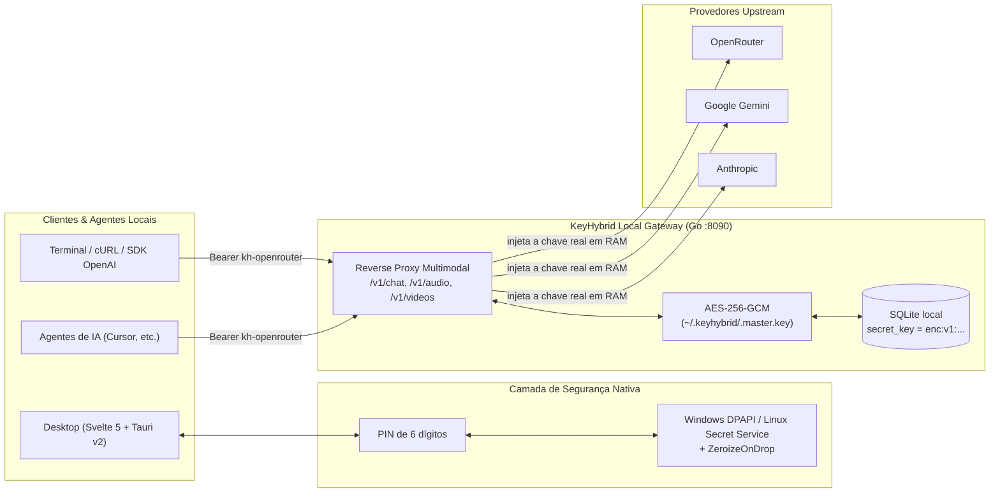

# 🛡️ KeyHybrid — Zero-Knowledge API Key Vault & Local AI Gateway

[](https://github.com/in100tiva/KeyHybrid/actions/workflows/ci.yml)
[](https://github.com/in100tiva/KeyHybrid/actions/workflows/codeql.yml)
[](https://github.com/in100tiva/KeyHybrid/releases)
[](https://github.com/in100tiva/KeyHybrid/pkgs/container/keyhybrid)
[](https://in100tiva.github.io/KeyHybrid/)
[](LICENSE)


> **Em 30 segundos:** um cofre local que guarda as chaves reais dos provedores de IA e expõe um gateway compatível com a API da OpenAI em `http://127.0.0.1:8090/v1`. Seus agentes usam tokens virtuais (`kh-openrouter`); a chave real nunca entra em `.env`, histórico de shell ou código.

O **KeyHybrid** é um cofre desktop para chaves de API de IA (**OpenRouter, Google Gemini, Anthropic**) combinado com um **reverse proxy local zero-knowledge**, construído em **Tauri v2 (Rust)**, **Svelte 5** e **Go (PocketBase)**.

Em vez de espalhar chaves reais (`sk-or-v1-...`, `AIza...`, `sk-ant-...`) por arquivos `.env`, scripts ou agentes autônomos, você armazena a chave **uma única vez** no cofre criptografado e usa apenas tokens virtuais (`Bearer kh-openrouter`).

## Por que existe

- **Chave vaza por acidente**: `.env` esquecido, histórico de shell, print de tela, commit.
- **Cada agente implementa auth do seu jeito** — e todos acabam precisando da chave real.
- **Trocar de provedor** não deveria significar editar dez arquivos de configuração.

## Como funciona



## Pilares de segurança

- **Isolamento por alias (`kh-<alias>`)**: nenhuma ferramenta externa vê a chave real; o gateway descriptografa em RAM só no instante da chamada HTTPS.
- **Criptografia dupla em repouso**: AES-256-GCM no SQLite com chave mestra local (`0600`) + DPAPI/Secret Service para credenciais e PIN, com `Zeroize` em Rust.
- **Fallback de guardrail**: se a OpenRouter recusar um modelo (`HTTP 404`), o gateway reroteia para `openrouter/auto` sem quebrar o agente.

## Download

| O que | Onde |
| --- | --- |
| **Binários do gateway** (Linux amd64/arm64, macOS amd64/arm64, Windows amd64) | [Releases](https://github.com/in100tiva/KeyHybrid/releases) — inclui `SHA256SUMS.txt` |
| **Imagem de container** (multi-arquitetura) | [`ghcr.io/in100tiva/keyhybrid`](https://github.com/in100tiva/KeyHybrid/pkgs/container/keyhybrid) |
| **App desktop** (`.deb`, `.msi`) | [Build a partir do código](docs/INSTALL.md) por enquanto — instaladores entram nas próximas releases |

Verificar a integridade de um download:

```bash
sha256sum -c SHA256SUMS.txt
```

## Quickstart

### Linux

```bash
git clone https://github.com/in100tiva/KeyHybrid.git
cd KeyHybrid
chmod +x install_linux.sh && ./install_linux.sh
```

### Windows

```powershell
git clone https://github.com/in100tiva/KeyHybrid.git
cd KeyHybrid
.\run_windows.bat
```

Pré-requisitos por distro e geração de instaladores (`.deb`, `.msi`) estão em **[docs/INSTALL.md](docs/INSTALL.md)**.

## Usar o gateway

Salve a chave na interface — o KeyHybrid gera o token virtual correspondente:

- **Base URL:** `http://127.0.0.1:8090/v1`
- **API key:** `kh-openrouter`

```bash
curl http://127.0.0.1:8090/v1/chat/completions \
  -H "Authorization: Bearer kh-openrouter" \
  -H "Content-Type: application/json" \
  -d '{"model":"openrouter/auto","messages":[{"role":"user","content":"oi"}]}'
```

Chaves de serviço (Vercel, Supabase, GitHub), `kh run` e limitações conhecidas: **[docs/USAGE.md](docs/USAGE.md)**.

## Rodar com Docker

O gateway é publicado como imagem pública no GHCR e roda como usuário não-root, com todo o estado em `/data`.

```bash
docker run --rm -p 127.0.0.1:8090:8090 \
  -v keyhybrid-data:/data \
  ghcr.io/in100tiva/keyhybrid:latest
```

Ou com Compose (`docker-compose.yml` incluso):

```bash
docker compose up -d
```

> A porta é publicada em `127.0.0.1` de propósito: o gateway rejeita `Host` que não seja loopback, como proteção contra DNS rebinding.

## Desenvolvimento

```bash
make help     # alvos disponíveis
make check    # go vet + svelte-check + cargo fmt --check
make test     # testes Go com -race
make build    # gateway + interface
make docker   # imagem local do gateway
```

| Componente | Stack | Comandos |
| --- | --- | --- |
| `apps/server` | Go 1.27 + PocketBase | `go build ./...`, `go test -race ./...` |
| `apps/desktop` | SvelteKit 3 + Svelte 5 + Tauri v2 | `pnpm run check`, `pnpm run build`, `cargo fmt --check` |

Guia completo em **[docs/INSTALL.md](docs/INSTALL.md)**.

## Qualidade e automação

| Item | Status |
| --- | --- |
| CI (Go + Rust + SvelteKit) | [`.github/workflows/ci.yml`](.github/workflows/ci.yml) — `gofmt`, `go vet`, `go build`, `go test -race`, `svelte-check`, build estático, `cargo fmt --check` e `cargo clippy -D warnings` |
| Revisão de dependências | [`.github/workflows/dependency-review.yml`](.github/workflows/dependency-review.yml) — barra PRs que adicionam dependências com severidade alta |
| Releases automatizadas | [`.github/workflows/release.yml`](.github/workflows/release.yml) — binários cross-compiled + checksums por tag `v*` |
| Imagem de container | [`.github/workflows/container.yml`](.github/workflows/container.yml) — multi-arquitetura publicada no GHCR |
| Análise estática | [CodeQL](https://github.com/in100tiva/KeyHybrid/security/code-scanning) (Go e JavaScript/TypeScript) |
| Dependências | Dependabot semanal para Go, npm, Cargo, Actions e Docker |
| Segurança do repositório | Secret scanning com push protection, Dependabot alerts e [política de segurança](SECURITY.md) |

## Documentação

- **[docs/INSTALL.md](docs/INSTALL.md)** — build do zero, dependências por sistema e empacotamento.
- **[docs/USAGE.md](docs/USAGE.md)** — gateway, aliases, `kh run` e integração com agentes.
- **[docs/SPEC-cofre-universal.md](docs/SPEC-cofre-universal.md)** — modelo de dados, criptografia e ciclo de vida da chave mestra.
- **[Site de documentação](https://in100tiva.github.io/KeyHybrid/)** — versão navegável publicada no GitHub Pages.

## Contribuir

Contribuições são bem-vindas. Leia **[CONTRIBUTING.md](CONTRIBUTING.md)** e o **[CODE_OF_CONDUCT.md](CODE_OF_CONDUCT.md)**.

- Bugs e sugestões: use os templates de issue.
- Dúvidas e ideias: [Discussões](https://github.com/in100tiva/KeyHybrid/discussions).
- Vulnerabilidades: **nunca** em issue pública — siga o **[SECURITY.md](SECURITY.md)**.
- Onde pedir ajuda / o que esperar de prazo: **[SUPPORT.md](SUPPORT.md)**.

## Roadmap

O que está planejado para a próxima release fica no milestone **[v0.2.0](https://github.com/in100tiva/KeyHybrid/milestone/1)**: instaladores desktop (`.deb`/`.msi`), múltiplos providers no gateway e assistente de migração de `.env`. Para propor algo novo, abra uma [discussão em Ideas](https://github.com/in100tiva/KeyHybrid/discussions/categories/ideas).

## Estrutura

```text
apps/server        # gateway Go (PocketBase) + cofre AES-256-GCM + proxy /v1
apps/desktop       # app Tauri v2 + SvelteKit 3 (PIN, cofre, UI)
docs/              # INSTALL.md, USAGE.md, SPEC e site do GitHub Pages
.github/           # workflows de CI/release/CodeQL, templates e Dependabot
Dockerfile         # imagem do gateway (build multi-stage, usuário não-root)
docker-compose.yml # execução local do gateway em 127.0.0.1:8090
```

## Licença

[MIT](LICENSE) © Luan Oliveira dos Santos
