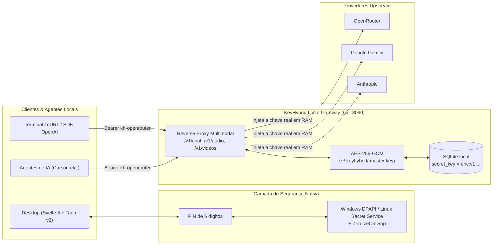

# 🛡️ KeyHybrid — Zero-Knowledge API Key Vault & Local AI Gateway

[](LICENSE)


> **Em 30 segundos:** um cofre local que guarda as chaves reais dos provedores de IA e expõe um gateway compatível com a API da OpenAI em `http://127.0.0.1:8090/v1`. Seus agentes usam tokens virtuais (`kh-openrouter`); a chave real nunca entra em `.env`, histórico de shell ou código.

O **KeyHybrid** é um cofre desktop para chaves de API de IA (**OpenRouter, Google Gemini, Anthropic**) combinado com um **reverse proxy local zero-knowledge**, construído em **Tauri v2 (Rust)**, **Svelte 5** e **Go (PocketBase)**.

Em vez de espalhar chaves reais (`sk-or-v1-...`, `AIza...`, `sk-ant-...`) por arquivos `.env`, scripts ou agentes autônomos, você armazena a chave **uma única vez** no cofre criptografado e usa apenas tokens virtuais (`Bearer kh-openrouter`).

## Por que existe

- **Chave vaza por acidente**: `.env` esquecido, histórico de shell, print de tela, commit.
- **Cada agente implementa auth do seu jeito** — e todos acabam precisando da chave real.
- **Trocar de provedor** não deveria significar editar dez arquivos de configuração.

## Como funciona



## Pilares de segurança

- **Isolamento por alias (`kh-<alias>`)**: nenhuma ferramenta externa vê a chave real; o gateway descriptografa em RAM só no instante da chamada HTTPS.
- **Criptografia dupla em repouso**: AES-256-GCM no SQLite com chave mestra local (`0600`) + DPAPI/Secret Service para credenciais e PIN, com `Zeroize` em Rust.
- **Fallback de guardrail**: se a OpenRouter recusar um modelo (`HTTP 404`), o gateway reroteia para `openrouter/auto` sem quebrar o agente.

## Quickstart

### Linux

```bash
git clone https://github.com/in100tiva/KeyHybrid.git
cd KeyHybrid
chmod +x install_linux.sh && ./install_linux.sh
```

### Windows

```powershell
git clone https://github.com/in100tiva/KeyHybrid.git
cd KeyHybrid
.\run_windows.bat
```

Pré-requisitos por distro e geração de instaladores (`.deb`, `.msi`) estão em **[docs/INSTALL.md](docs/INSTALL.md)**.

## Usar o gateway

Salve a chave na interface — o KeyHybrid gera o token virtual correspondente:

- **Base URL:** `http://127.0.0.1:8090/v1`
- **API key:** `kh-openrouter`

```bash
curl http://127.0.0.1:8090/v1/chat/completions \
  -H "Authorization: Bearer kh-openrouter" \
  -H "Content-Type: application/json" \
  -d '{"model":"openrouter/auto","messages":[{"role":"user","content":"oi"}]}'
```

Chaves de serviço (Vercel, Supabase, GitHub), `kh run` e limitações conhecidas: **[docs/USAGE.md](docs/USAGE.md)**.

## Estrutura

```text
apps/server    # gateway Go (PocketBase) + cofre AES-256-GCM + proxy /v1
apps/desktop   # app Tauri v2 + Svelte 5 (PIN, cofre, UI)
docs/          # INSTALL.md e USAGE.md
```

## Licença

[MIT](LICENSE) © Luan Oliveira dos Santos
