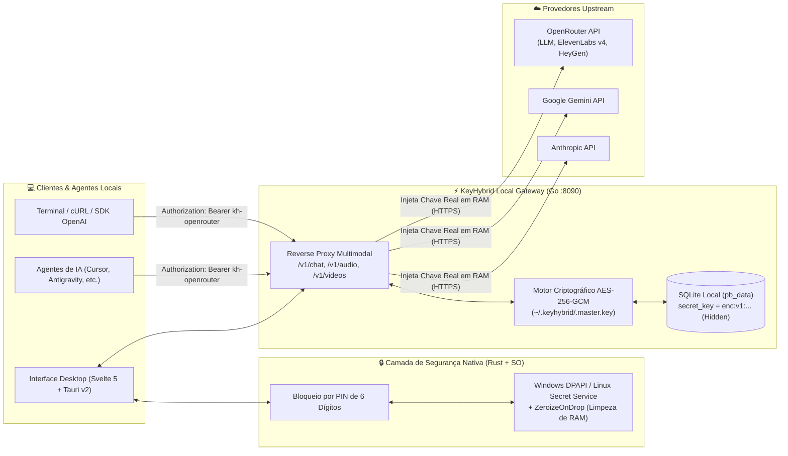

# 🛡️ KeyHybrid — Zero-Knowledge API Key Vault & Local AI Gateway

O **KeyHybrid** é um cofre desktop de segurança para chaves de API de Inteligência Artificial (**OpenRouter, Google Gemini, Anthropic**) combinado com um **Reverse Proxy Local Zero-Knowledge** (`http://127.0.0.1:8090/v1`), construído em **Tauri v2 (Rust)**, **Svelte 5** e **Go (PocketBase)**.

Em vez de expor suas chaves reais (`sk-or-v1-...`, `AIza...`, `sk-ant-...`) em arquivos `.env`, histórico de terminal, scripts ou agentes autônomos de código, você armazena a chave real **uma única vez** dentro do cofre criptografado do **KeyHybrid** e utiliza apenas **Tokens Virtuais** (`Bearer kh-openrouter`).

---

## 🏗️ Arquitetura do Sistema



### Pilares da Arquitetura de Segurança

1. **Isolamento Zero-Knowledge (`kh-<alias>`):**
   - Nenhuma ferramenta externa, agente de IA ou script tem acesso à sua chave real.
   - Os clientes chamam `http://127.0.0.1:8090/v1/...` enviando `Authorization: Bearer kh-openrouter`.
   - O Gateway Go localiza o registro correspondente, descriptografa a chave real em memória volátil (RAM) apenas no instante de abrir a requisição HTTPS para o provedor externo e jamais retorna a chave em endpoints de listagem.
2. **Criptografia Dupla em Repouso (`AES-256-GCM` + Cofre do Sistema Operacional):**
   - **No Banco SQLite (`apps/server/pb_data`):** Cada `secret_key` é criptografada antes de ir para o disco com **AES-256-GCM** (`enc:v1:<nonce+ciphertext>`) utilizando uma chave mestra local de 256 bits gerada com CSPRNG em `~/.keyhybrid/.master.key` (permissão `0600`). Além disso, a coluna possui `Hidden: true` no motor do PocketBase.
   - **No Sistema Operacional (`apps/desktop/src-tauri/src/vault.rs`):** As credenciais e o PIN de 6 dígitos são protegidos via **Windows DPAPI (Credential Manager)** no Windows e **Linux Secret Service (`libsecret` / `gnome-keyring`)** no Linux (com fallback automático para `~/.keyhybrid/.pin.vault` em ambientes Linux minimalistas). Todos os segredos em Rust implementam `Zeroize` e `ZeroizeOnDrop` para zerar os bytes da memória RAM imediatamente após o uso.
3. **Auto-Healing & Guardrail Fallback:**
   - Caso uma requisição na OpenRouter falhe por restrição de modelo em *Guardrail* (`HTTP 404`), o Gateway refaz automaticamente o roteamento para `openrouter/auto` sem interromper o agente cliente.
4. **Módulo Opcional de Assistente Tática (`/F.R.I.D.A.Y` — Sexta-Feira):**
   - Habilitado exclusivamente quando há uma chave da OpenRouter ativa no cofre.
   - Escuta local via `faster-whisper` + `sounddevice` (`apps/server/friday_ear.py`), síntese de voz neural via `elevenlabs/eleven-v4-turbo` e controle local de dispositivos IoT Xiaomi na LAN via protocolo `MiIO UDP 54321` (`AES-128-CBC`).

---

## 📂 Estrutura de Diretórios

```text
KeyHybrid/
├── apps/
│   ├── server/                  # Backend Gateway & Proxy Reverso em Go (PocketBase)
│   │   ├── main.go              # Servidor HTTP (:8090), Cofre AES-256-GCM, Proxy /v1/* e MiIO UDP
│   │   ├── friday_ear.py        # Daemon opcional de voz local (faster-whisper + sounddevice)
│   │   ├── go.mod               # Dependências Go
│   │   └── go.sum
│   └── desktop/                 # Aplicativo Desktop Nativo (Svelte 5 + Tauri v2)
│       ├── src/
│       │   └── routes/
│       │       └── +page.svelte # UI Minimalista, Constelação Orbital, Efeito macOS Genie e PIN
│       └── src-tauri/           # Core Nativo em Rust
│           ├── Cargo.toml       # Dependências multiplataforma (Windows DPAPI / Linux Secret Service)
│           └── src/
│               ├── lib.rs       # Auto-starter do servidor Go e controle de janela sem bordas
│               ├── vault.rs     # Integração com Keyring do SO + ZeroizeOnDrop + PIN de 6 dígitos
│               └── gateway.rs   # Ponte assíncrona Rust <-> Gateway Go
├── install_linux.sh             # Instalador automatizado para Linux
├── run_linux.sh                 # Inicializador rápido para Linux (Gateway + Desktop)
├── run_windows.bat              # Inicializador rápido de 1 clique para Windows
├── run_server.bat               # Inicia apenas o servidor Go no Windows
└── run_desktop.bat              # Inicia apenas a interface Tauri no Windows
```

---

## 🐧 Guia de Instalação no Linux (PCs do Escritório)

### 1. Pré-requisitos de Sistema

Escolha o comando correspondente à distribuição Linux dos computadores do escritório:

#### Ubuntu / Debian / Linux Mint / Pop!_OS:
```bash
sudo apt-get update && sudo apt-get install -y \
  libwebkit2gtk-4.1-dev \
  build-essential \
  curl \
  wget \
  file \
  libxdo-dev \
  libssl-dev \
  libayatana-appindicator3-dev \
  librsvg2-dev \
  libsecret-1-dev \
  libasound2-dev \
  portaudio19-dev \
  ffmpeg \
  golang-go \
  nodejs \
  npm
```

#### Fedora / RHEL / CentOS:
```bash
sudo dnf install -y \
  webkit2gtk4.1-devel \
  openssl-devel \
  curl \
  wget \
  file \
  libappindicator-gtk3-devel \
  librsvg2-devel \
  libsecret-devel \
  alsa-lib-devel \
  portaudio-devel \
  ffmpeg \
  golang \
  nodejs \
  npm
```

#### Arch Linux / Manjaro:
```bash
sudo pacman -S --needed \
  webkit2gtk-4.1 \
  base-devel \
  curl \
  wget \
  file \
  openssl \
  libappindicator-gtk3 \
  librsvg \
  libsecret \
  alsa-lib \
  portaudio \
  ffmpeg \
  go \
  nodejs \
  npm
```

#### Instalar o Rust (caso ainda não esteja instalado na máquina):
```bash
curl --proto '=https' --tlsv1.2 -sSf https://sh.rustup.rs | sh -s -- -y
source "$HOME/.cargo/env"
```

---

### 2. Clonar e Instalar no Linux (1 Comando)

```bash
git clone https://github.com/in100tiva/KeyHybrid.git
cd KeyHybrid
chmod +x install_linux.sh run_linux.sh
./install_linux.sh
```

O script `install_linux.sh` irá:
1. Verificar/instalar as bibliotecas de sistema necessárias;
2. Compilar o binário nativo `apps/server/keyhybrid-server` em Go e copiá-lo para `~/.keyhybrid/bin/keyhybrid-server`;
3. Instalar as dependências do frontend em `apps/desktop`.

### 3. Executar no Linux

```bash
./run_linux.sh
```

### 4. Gerar Instalador Nativo do Linux (`.deb` / `.AppImage` / `.rpm`)

Se quiser gerar o pacote instalável para distribuir nos outros PCs Linux do escritório:

```bash
cd apps/desktop
npm run tauri build
```
Os pacotes prontos ficarão em `apps/desktop/src-tauri/target/release/bundle/`.

---

## 🪟 Guia de Instalação no Windows (Windows 10 / 11)

### 1. Pré-requisitos no Windows

Abra o **PowerShell** e instale as ferramentas base via `winget` (caso ainda não possua):

```powershell
winget install GoLang.Go
winget install Rustlang.Rustup
winget install OpenJS.NodeJS.LTS
```
*(Nota: Para compilar projetos Rust no Windows, certifique-se de ter o **Microsoft C++ Build Tools** instalado).*

### 2. Clonar e Executar no Windows

```powershell
git clone https://github.com/in100tiva/KeyHybrid.git
cd KeyHybrid
.\run_windows.bat
```

O script `run_windows.bat` compila automaticamente o `apps\server\keyhybrid-server.exe` (caso ainda não exista), sobe o Gateway silenciosamente em `127.0.0.1:8090` e abre a janela do **KeyHybrid Desktop**.

### 3. Gerar Instalador `.msi` / `.exe` para Windows

```powershell
# 1. Compilar o servidor Go
cd apps\server
go build -o keyhybrid-server.exe .

# 2. Compilar o instalador Desktop Tauri
cd ..\desktop
npm install
npm run tauri build
```

---

## 🔌 Como Usar o Gateway Local nos seus Projetos e Agentes

Assim que você salvar sua chave (ex: `openrouter`) na interface do **KeyHybrid**, ela gera o token virtual **`kh-openrouter`**.

### 1. Configuração em Agentes de IA / SDKs compatíveis com OpenAI
- **Base URL:** `http://127.0.0.1:8090/v1`
- **API Key:** `kh-openrouter`

### 2. Chat / Completions (`POST /v1/chat/completions`)
```bash
curl http://127.0.0.1:8090/v1/chat/completions \
  -H "Content-Type: application/json" \
  -H "Authorization: Bearer kh-openrouter" \
  -d '{
    "model": "openrouter/auto",
    "messages": [
      {"role": "user", "content": "Explique a arquitetura Zero-Knowledge do KeyHybrid."}
    ]
  }'
```

### 3. Text-to-Speech / Voz (`POST /v1/audio/speech`)
```bash
curl http://127.0.0.1:8090/v1/audio/speech \
  -H "Content-Type: application/json" \
  -H "Authorization: Bearer kh-openrouter" \
  -d '{
    "model": "elevenlabs/eleven-v4-turbo",
    "input": "Cofre KeyHybrid operacional, chefe.",
    "voice": "alice",
    "response_format": "mp3"
  }' --output resposta.mp3
```

### 4. Geração de Vídeo Assíncrona (`POST /v1/videos`)
```bash
curl http://127.0.0.1:8090/v1/videos \
  -H "Content-Type: application/json" \
  -H "Authorization: Bearer kh-openrouter" \
  -d '{
    "model": "heygen/heygen-video-1",
    "prompt": "Apresentador em estúdio futurista falando sobre cibersegurança."
  }'
```

---

## 🔐 Chaves de serviço (Vercel, Supabase, GitHub…)

Para qualquer API que não seja de IA, escolha no seletor **Provedor** um item do grupo **Serviços** (vercel, supabase, github ou outro; na API, `kind: "service"`), informando o alias e a URL base (`https://`). O segredo não sai do KeyHybrid.

**Proxy:** chame a API pelo gateway com o token local. A chave entra no cabeçalho só dentro do gateway:

```bash
curl -H "X-KeyHybrid-Token: $(cat ~/.keyhybrid/.cli.token)" \
  http://127.0.0.1:8090/proxy/<alias>/v9/projects
```

**`kh run`:** para CLIs que não aceitam trocar a URL da API. Injeta a variável só no processo filho:

```bash
kh run --env VERCEL_TOKEN=<alias> -- vercel deploy
```

Fora de terminal (agente, pipe, log) o segredo sai mascarado como `****`. Em terminal interativo a saída passa direto.

**Limites:**
- Um processo malicioso rodando como o seu usuário continua podendo ler a chave.
- Não há PIN para liberar chave de produção.
- APIs que exigem dois cabeçalhos com a chave (ex.: PostgREST do Supabase, `apikey` + `Authorization`) não funcionam. A Management API do Supabase funciona.
- A interface ainda usa só `Authorization: Bearer`; cabeçalho customizado só pela API.
- No Windows, `kh run` funciona pelo binário (`keyhybrid-server.exe run …`); o atalho `kh` é só Linux.

---

## 🎙️ Ativando o Ouvido Local da Assistente Sexta-Feira (Opcional)

Se quiser usar o reconhecimento de voz contínuo pelo microfone físico (Windows ou Linux):

```bash
pip install faster-whisper sounddevice av numpy
python apps/server/friday_ear.py
```
*(Para controlar uma lâmpada Xiaomi localmente via UDP 54321, crie o arquivo `apps/server/.xiaomi_token` contendo os 32 caracteres hexadecimais do token MiIO da sua lâmpada ou defina a variável de ambiente `XIAOMI_BULB_TOKEN`).*
